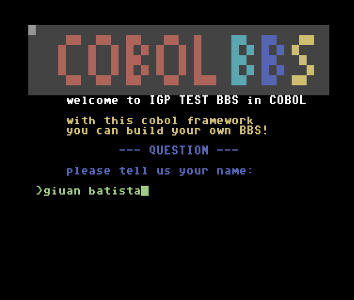
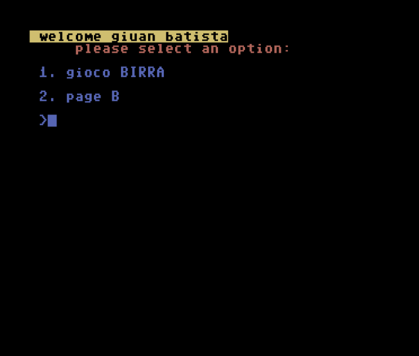
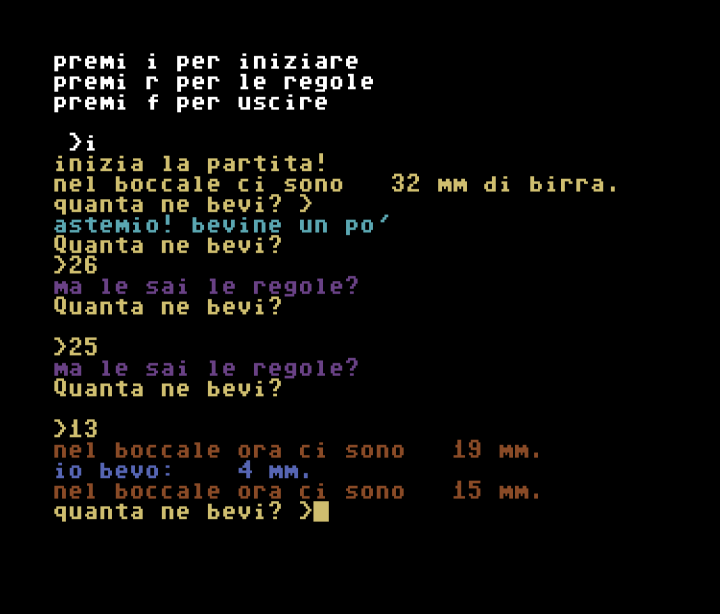

# A Template to Build your BBS in pure COBOL (AcuCobol-GT with C$SOCKET routine)
You can build your personal BBS easily with this solution template.
It works on all CP437 terminals and supports UPPER and lower case charset.
All these pages are included with a sample of news management too, to help you start building your own BBS.
A game is also included (BIRRA)

You have included also: 
- routines to handle cursor color and movement
- routines to convert to Petscii code
